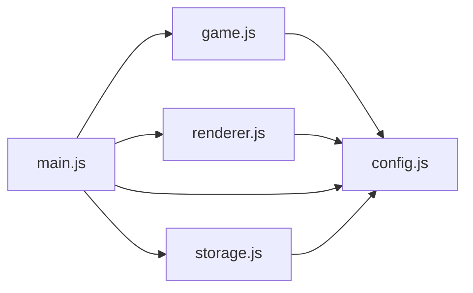
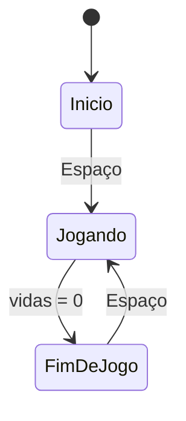

# Design: Chuva de Bugs

## Visão geral
O projeto será um jogo web simples em HTML, CSS e JavaScript puro, executado com Canvas 2D. A partida terá três estados: início, jogando e fim de jogo. Um módulo central controlará o estado do jogo, a entrada do jogador, os itens, as colisões e a dificuldade, enquanto módulos menores farão renderização e persistência do recorde.

## Decisões técnicas
| Decisão | Escolha | Por quê |
|---|---|---|
| Linguagem | JavaScript ES modules | Permite dividir responsabilidades sem frameworks ou etapa de build. |
| Gráficos | Canvas 2D e emojis | Produz o visual pedido sem arquivos de imagem ou áudio. |
| Loop | `requestAnimationFrame` com delta time | Mantém o movimento proporcional ao tempo real. |
| Estado | Máquina de estados simples no módulo principal do jogo | Reduz a complexidade entre início, partida e fim de jogo. |
| Persistência | `localStorage` | Preserva o recorde sem backend ou conta de usuário. |

## Arquitetura


## Estrutura de arquivos
```text
index.html               Estrutura da página e inclusão do módulo principal.
style.css                Área central do jogo e apresentação externa do Canvas.
src/config.js            Constantes ajustáveis do jogo.
src/main.js              Inicialização, loop e comunicação entre módulos.
src/game.js              Estado da partida, entrada, itens, colisões e dificuldade.
src/renderer.js          Desenha personagens, itens, textos e telas no Canvas.
src/storage.js           Lê e grava o recorde no navegador.
```

## Componentes

### `src/main.js`: Inicialização e loop principal
- **Responsabilidade:** iniciar o Canvas, capturar o teclado e executar o quadro por `requestAnimationFrame`.
- **Estado:** referência ao jogo, ao renderizador, ao último tempo do quadro e ao estado de armazenamento.
- **Funções principais:** `init()`: monta os módulos, registra eventos e inicia o loop; `frame(currentTime)`: calcula o delta time, atualiza o jogo, desenha o estado atual e agenda o próximo quadro.
- **Atende:** 1.1, 1.2, 1.3, 2.1, 2.2, 4.1, 4.2, 5.1, 5.2, 5.3, 5.4, 5.5

### `src/game.js`: Regras da partida
- **Responsabilidade:** manter o estado da partida e aplicar movimento, criação de itens, colisões, pontuação, vidas e dificuldade.
- **Estado:** estado da tela, pontuação, vidas, dev, lista de itens, tempo de partida, relógio de criação e dificuldade atual.
- **Funções principais:** `startGame()`: reinicia a partida com 0 pontos e 3 vidas; `update(deltaTime, input)`: atualiza movimentos e itens; `movePlayer(direction, deltaTime)`: move o dev sem ultrapassar os limites; `spawnItem()`: cria aleatoriamente café ou bug; `checkCollisions()`: aplica pontos ou perde vidas e remove o item colidido; `setInputState(keys)`: registra teclas pressionadas.
- **Atende:** 1.3, 2.1, 2.2, 2.3, 3.1, 3.2, 3.3, 3.4, 4.1, 4.2, 5.1, 5.5

### `src/renderer.js`: Desenho e interface do Canvas
- **Responsabilidade:** desenhar o fundo, dev, itens, informações da partida e cada uma das três telas.
- **Estado:** contexto 2D do Canvas e referências aos dados exibidos pelo jogo.
- **Funções principais:** `draw(gameState)`: escolhe e desenha o estado atual; `drawStartScreen()`: desenha título e instrução de início; `drawPlayingScreen(game)`: desenha dev, itens, pontuação e vidas; `drawGameOverScreen(game)`: desenha pontuação, recorde e instrução de reinício.
- **Atende:** 1.1, 1.2, 1.3, 3.1, 3.2, 3.3, 5.2, 5.3, 5.4

### `src/storage.js`: Persistência do recorde
- **Responsabilidade:** carregar e atualizar o maior resultado no armazenamento local do navegador.
- **Estado:** chave usada pelo `localStorage`.
- **Funções principais:** `loadHighScore()`: retorna o recorde salvo ou zero; `saveHighScore(score)`: atualiza o recorde apenas quando `score` é maior.
- **Atende:** 5.3, 6.1, 6.2

### `src/config.js`: Configuração central
- **Responsabilidade:** concentrar todas as constantes ajustáveis do jogo em um único objeto exportado `CONFIG`.
- **Estado:** objeto constante exportado com dimensões, velocidades, intervalos, tamanhos, cores, emojis, vidas iniciais e regras de dificuldade.
- **Funções principais:** nenhuma; serve como fonte de configuração para os demais módulos.
- **Atende:** 2.3, 3.1, 3.2, 3.3, 4.1, 4.2

## Configuração central (`CONFIG` em `src/config.js`)
| Constante | Valor inicial | Para que serve | Atende |
|---|---|---|---|
| `canvasWidth` | `800` | Define a largura da área de jogo. | 2.3 |
| `canvasHeight` | `600` | Define a altura da área de jogo. | 2.3, 3.4 |
| `playerWidth` | `44` | Define a largura do dev usada em movimento e colisão. | 2.3, 3.2, 3.3 |
| `playerHeight` | `44` | Define a altura do dev usada em movimento e colisão. | 3.2, 3.3 |
| `playerSpeed` | `320` | Define quantos pixels o dev percorre por segundo. | 2.1, 2.2 |
| `initialLives` | `3` | Define as vidas da nova partida. | 1.3, 5.1, 5.5 |
| `itemSize` | `36` | Define o tamanho usado no desenho e na colisão dos itens. | 3.2, 3.3, 3.4 |
| `initialFallSpeed` | `150` | Define a velocidade inicial de queda dos itens. | 4.1 |
| `fallSpeedIncrease` | `8` | Define o aumento de velocidade por segundo de partida. | 4.1 |
| `maximumFallSpeed` | `360` | Limita a velocidade máxima de queda. | 4.1 |
| `initialSpawnInterval` | `0.9` | Define o intervalo inicial entre itens criados. | 4.2 |
| `minimumSpawnInterval` | `0.35` | Limita o intervalo mínimo entre itens. | 4.2 |
| `spawnIntervalDecrease` | `0.01` | Reduz o intervalo por segundo de partida. | 4.2 |
| `coffeeEmoji` | `"☕"` | Define o símbolo gráfico do café. | 3.2 |
| `bugEmoji` | `"🐛"` | Define o símbolo gráfico do bug. | 3.3 |
| `playerEmoji` | `"🧑‍💻"` | Define o símbolo gráfico do dev. | 2.1, 2.2 |
| `storageKey` | `"chuvaDeBugsHighScore"` | Identifica o recorde no armazenamento local. | 6.1, 6.2 |

## Fluxo


No início de cada partida, o jogo recebe o estado inicial do módulo `game.js`: pontuação zero, 3 vidas e dificuldade inicial. A cada quadro, `main.js` calcula o delta time; `game.js` registra as teclas, move o dev, cria itens e atualiza suas posições; colisões alteram pontos ou vidas; quando as vidas chegam a zero, a pontuação é comparada ao recorde salvo; `renderer.js` desenha o estado atual. Ao receber Espaço nas telas inicial ou de fim de jogo, o `game.js` reinicia a partida imediatamente.

## Propriedades de corretude
- Para qualquer quadro, o dev deve permanecer dentro dos limites horizontais da área do jogo. (Valida: 2.3)
- Para qualquer café coletado pelo dev, o café deve ser removido e os pontos devem aumentar exatamente 1. (Valida: 3.2)
- Para qualquer bug que toque o dev, o bug deve ser removido e as vidas devem diminuir exatamente 1. (Valida: 3.3)
- Para qualquer item, ao atingir o chão sem colidir com o dev, ele deve ser removido sem alterar pontos ou vidas. (Valida: 3.4)
- Para qualquer instante da partida, a velocidade e a frequência dos itens devem respeitar seus limites configurados. (Valida: 4.1, 4.2)
- Para qualquer pontuação maior que o recorde salvo, o armazenamento local deve receber essa nova pontuação. (Valida: 6.1, 6.2)

## Casos limite
- Ao iniciar ou reiniciar, pontuação e vidas são zeradas no sentido definido pela regra: 0 pontos e 3 vidas.
- Manter uma tecla de movimento pressionada move o dev continuamente até o limite da tela ou até a tecla ser solta.
- Se cafés e bugs forem criados fora da área visual, o item é recolocado dentro dos limites horizontalmente válidos.
- Quando dois bugs colidem quase ao mesmo tempo, cada colisão válida reduz a vida uma única vez.
- Se `localStorage` estiver indisponível ou contiver um valor inválido, o recorde exibido será tratado como zero.
- Se a aba ficar em segundo plano, o movimento não acumula tempo excessivo porque o delta time deve ser calculado pelo intervalo real desde o último quadro, limitado pelo valor configurado.
